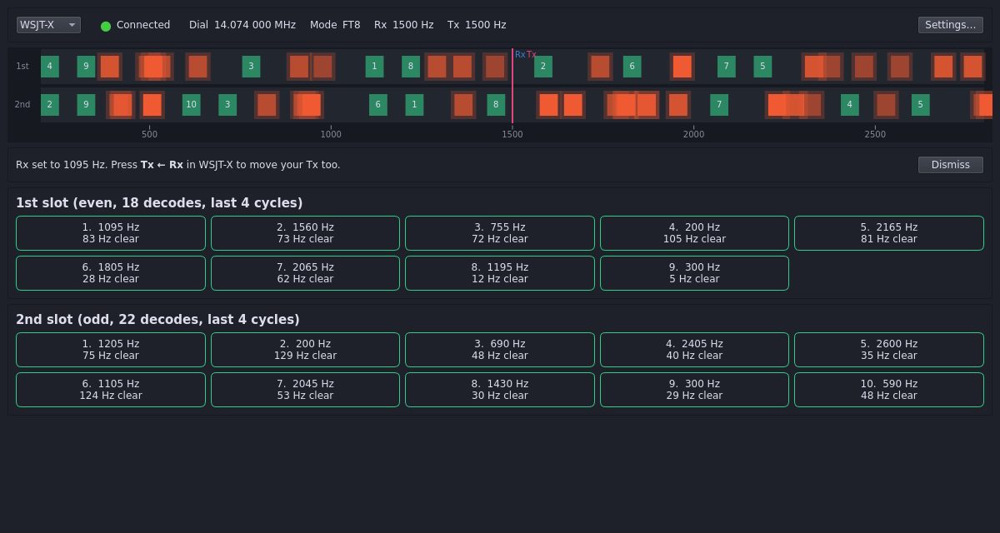
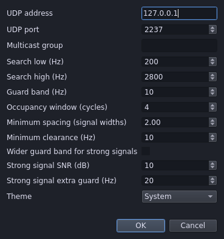
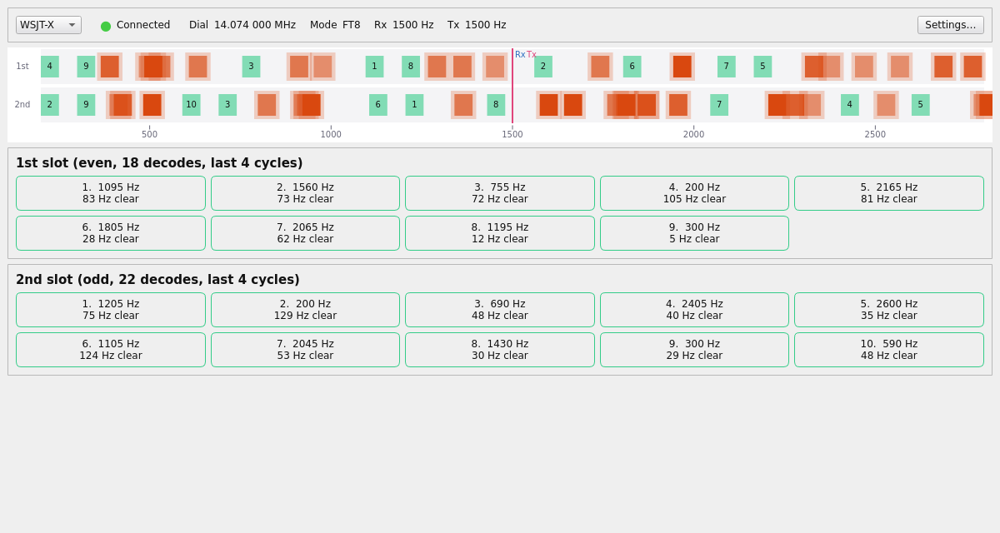

# WSJT-X Free Frequency

Listens to WSJT-X decodes and recommends audio offsets that nobody else is transmitting on, separately for each slot. Click one and WSJT-X's Rx moves there.



## How it works

Every decode WSJT-X makes is assigned to the **1st** (even) or **2nd** (odd) slot. The app keeps the decodes from the last few cycles of each slot as **occupancy**: each one covers its signal width (50 Hz for FT8, 83 Hz for FT4) plus a guard band either side. A **free location** is an audio offset where your signal fits without touching any occupancy in that slot.

- **Band map:** one lane per slot on a shared audio offset axis. Occupied signals are orange, fading as they age; free locations are numbered green blocks; your Rx and Tx are the blue and pink lines.
- **Free location buttons:** up to ten per slot, best first. Each shows its audio offset and the gap to the nearest signal. Free locations next to stale signals rank above ones next to fresh signals, and ties go to the one closest to your Tx.
- **Set Rx:** click a button, or anywhere on the band map, and WSJT-X's Rx moves there. WSJT-X can't set Tx over UDP, so press **Tx ← Rx** in WSJT-X to move your Tx too (see [ADR 0001](docs/adr/0001-set-rx-only.md)).

FT8 and FT4 are supported. Other modes show "Unsupported mode". Changing band or mode clears the occupancy.

A free location is only as good as the decodes behind it: a station too weak to decode doesn't show up as occupancy.

## Install

Requires Python 3.10 or newer. PyQt6 is installed automatically.

```sh
python3 -m venv .venv
source .venv/bin/activate
pip install -e .
```

Or install the wheel from a [release](https://github.com/vk5as/wsjtx-free-freq/releases): `pip install wsjtx_free_freq-<version>-py3-none-any.whl`.

## Set up WSJT-X

In WSJT-X, open **File → Settings → Reporting** and set:

- **UDP Server:** `127.0.0.1`, port `2237`. These are the app's defaults.
- **Accept UDP requests:** ticked. Without it, WSJT-X ignores **Set Rx**.

Then run:

```sh
wsjtx-free-freq
```

The header shows **Connected** once WSJT-X's first message arrives, along with its dial frequency, mode, Rx and Tx. With more than one WSJT-X running (for example `--rig-name`), choose one from the dropdown on the left. Each has its own occupancy.

### Sharing WSJT-X with GridTracker or JTAlert

Only one program can listen on a unicast UDP port. To share WSJT-X's stream, have WSJT-X send to a multicast group (for example `224.0.0.1`), and enter the same group under **Multicast group** in this app's Settings and in your other programs.

## Settings



| Setting | Default | What it does |
| --- | --- | --- |
| UDP address, port | `127.0.0.1`, `2237` | Where to listen for WSJT-X |
| Multicast group | empty | Join this IPv4 multicast group instead of listening unicast |
| Search low, high | 200–2800 Hz | Audio offsets to search; keeps clear of your rig's filter edges |
| Guard band | 10 Hz | Kept clear either side of every occupied signal |
| Occupancy window | 4 cycles | How many cycles of each slot count as occupancy |
| Minimum spacing | 2 signal widths | How far apart the recommended free locations are |
| Minimum clearance | 10 Hz | Free locations closer than this to a signal are left out |
| Wider guard band for strong signals | off | Gives decodes at or above the SNR threshold the extra guard band |
| Theme | System | System (follows your OS), Light or Dark |

Settings are saved between runs.

## Themes



## Platform support

Linux and Windows are the primary targets.

macOS support is best effort. The author has not tested this application on real Mac hardware, so it may not behave correctly there.

## Development

```sh
pip install -e ".[dev]"
python scripts/fake_wsjtx.py --decodes 20   # a fake WSJT-X: Status plus FT8 decodes every second, on 127.0.0.1:2237
python scripts/take_screenshots.py          # regenerate the images in docs/images/
```

Domain terms are defined in [GLOSSARY.md](GLOSSARY.md), and design decisions are in [docs/adr/](docs/adr/).

## Licence

MIT. See [LICENSE](LICENSE).
